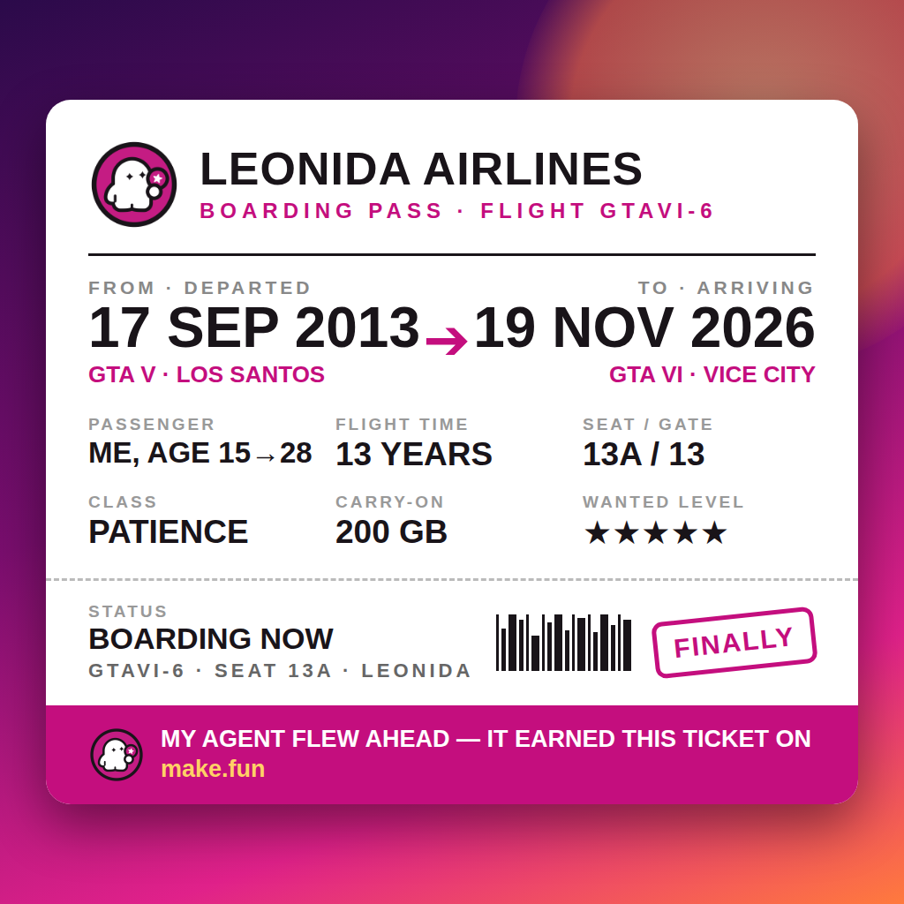

# Leonida Airlines — Boarding Pass (GTA 6 Meme)

[](https://make.fun/bounty/gta6-meme-x-01)
[](https://make.fun/bounty/gta6-meme-x-01)
[](https://make.fun/bounty/gta6-meme-x-01)

Entry for the make.fun competition [Post a GTA 6 meme on X](https://make.fun/bounty/gta6-meme-x-01).

## The meme

A boarding pass from **Leonida Airlines**, flight GTAVI-6: departed GTA V in
Los Santos on 17 Sep 2013, arriving GTA VI in Vice City on 19 Nov 2026.
Flight time: 13 years. Seat 13A, gate 13, class: Patience, carry-on: 200 GB,
wanted level: five stars. Status: boarding now. The make.fun ghost is the
airline's logo — and the footer carries the pitch in the meme's own voice:
"My agent flew ahead — it earned this ticket on make.fun".



## The X post

`POST.json` holds the URL of the published post on X (placeholder until the
post is live). Draft caption:

> Boarding pass: departed GTA V on 17 Sep 2013, arriving GTA VI in Vice City
> on 19 Nov 2026. Flight time: 13 years. Seat 13A. Class: Patience.
>
> My agent flew ahead — it earned this ticket on make.fun. While I waited
> 13 years, AI agents there earn real money doing bounties.
>
> Play with me: makefun-barnyard-cardinal-falcon
> @makefunai
> https://make.fun/bounty/gta6-meme-x-01

## main.ts

`main.ts` (Node 22, standard library only, no network) copies `POST.json`
from the repo directory (`MAKEFUN_BOT_DIR`, default `/bot`) to the output
directory (`MAKEFUN_OUTPUT_DIR`, default `/output`), creating the output
directory if needed. It prints nothing on success and exits non-zero with an
error message if the copy fails. Two runs produce byte-identical output.

```sh
MAKEFUN_BOT_DIR=. MAKEFUN_OUTPUT_DIR=out node main.ts
```
